# Windows アプリの画面

Windows アプリ(Electron)の画面と、その移り方です。画面そのものは Android アプリと共通で(`web/`)、ウィンドウが広いぶん、項目が横に並びます。

画像は、本体を USB で接続して撮ったものです(`mise run win-shot`)。Wi-Fi の SSID、IP アドレス、API キーはモザイクにしています。

## 画面遷移

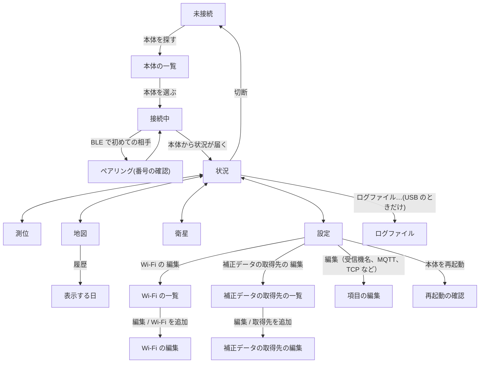

- 測位、状況、地図、衛星、設定は、下端のタブで行き来します。タブは、接続している間だけ出ます。
- 右上の `切断` は、どのタブからでも押せます。切断すると、未接続の画面に戻ります。
- 本体の画面(Setup → Bluetooth → Disconnect)から切断されたときも、未接続の画面に戻ります。

## 接続

| 画面 | 内容と操作 |
|---|---|
| 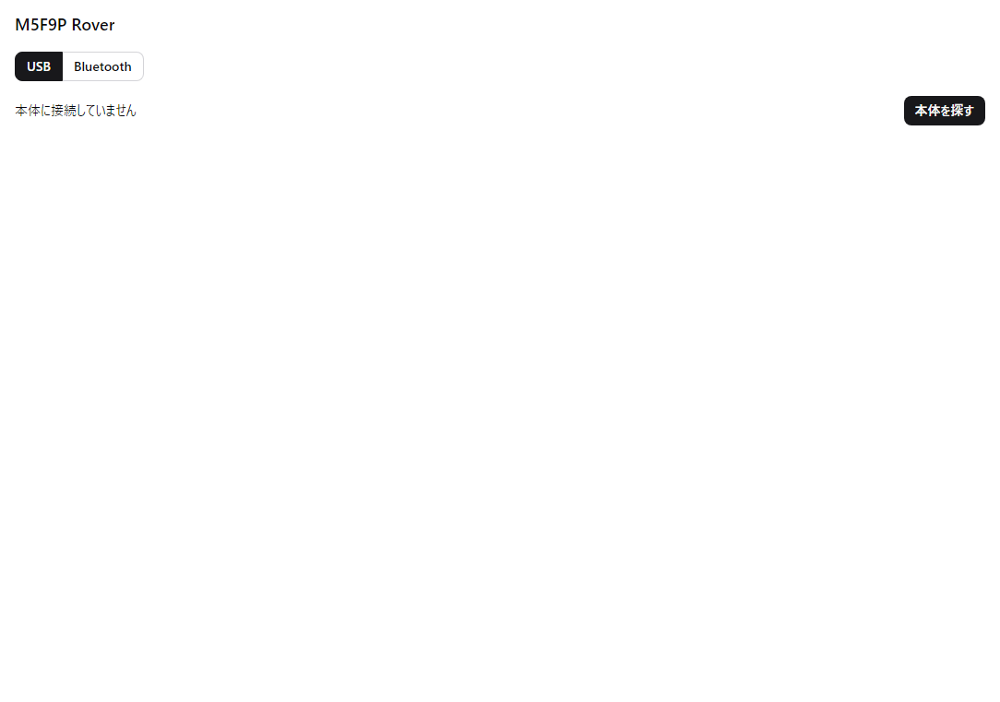 | **未接続** 起動すると、この画面が出ます。接続の方法(`USB` / `Bluetooth`)を選び、`本体を探す` を押します。 |
| 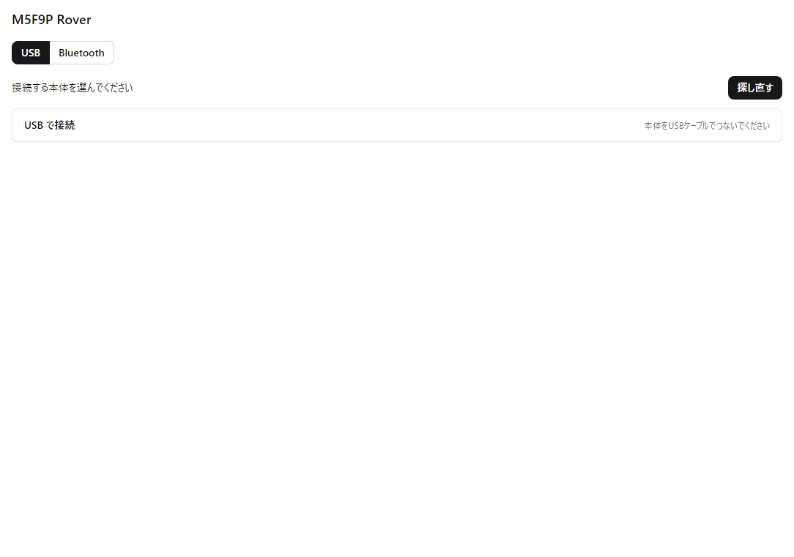 | **本体の一覧(USB)** `USB で接続` を押すと、USB ケーブルでつないだ本体に接続します。ポートを選ぶ画面は出ません(アプリが本体を見つけます)。 |
| 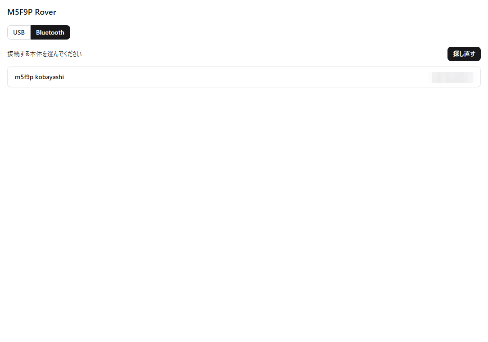 | **本体の一覧(Bluetooth)** 見つかった本体が並びます。本体を押すと接続します。ほかの端末(Android アプリなど)が接続している本体は、`ほかの端末が接続中` と出て、選べません。 |

本体を選ぶと「接続しています…」「本体からの状況を待っています…」と出て、状況が届くと「状況」のタブに移ります。

BLE で初めて接続するときは、本体の画面とアプリの両方に同じ6桁の番号が出ます。アプリの「ペアリング」の画面で「同じ」を押し、本体の画面でも `Same` を押すと、接続が続きます。一度ペアリングすれば、次からは出ません。この画面の画像は載せていません(撮るには、ペアリングの解除が必要なため)。

## 測位

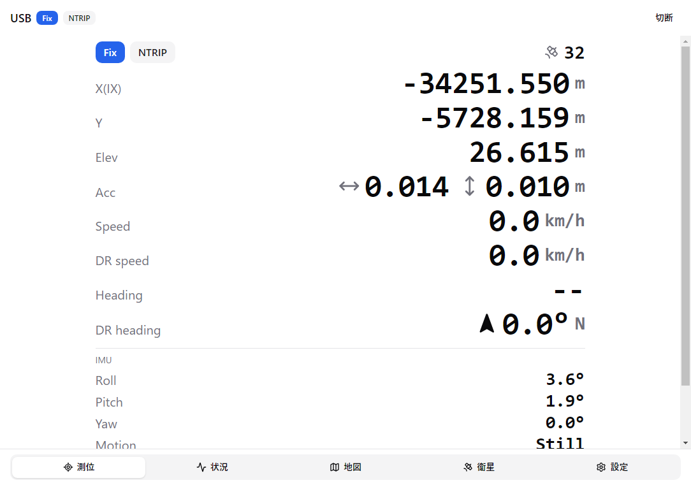

本体の画面の Status と同じ項目を、大きな文字で表示します。屋外で端末を表示器として見るときに使います。見出しは本体の画面と同じく英語で、1行に見出しと値(右寄せ)を並べます。

- 上段: 測位の状態と補正の方法のバッジ、ログの保存中の `REC`(点滅する赤い丸)、衛星数
- `Lat`、`Lon`: 緯度、経度。下段の「座標の形」で `度分秒` にすると度分秒(`35°41'28.50705"N`)、`XY` にすると `X(IX)`、`Y`(平面直角座標、m。系は設定タブで選ぶ)に替わります
- `Elev` / `Alt`: 標高。設定の「標高を表示する」を切ったときと、ジオイド高が届かないときは楕円体高(`Alt`)
- `Acc`: 精度(左右の矢印が水平、上下の矢印が垂直。m)
- `Speed`、`DR speed`、`Heading`、`DR heading`: 速度(km/h)と方角(進行方向の角度と16方位、進行方向に向けた矢印)。止まっている間(1 km/h 未満)は、方角を `--` にします。`DR` の付いた行は IMU の推測航法の値で、GNSS の値のすぐ下に並べます(IMU を使うときだけ)。
- `IMU`(本体の設定で IMU を使うときだけ): `Roll`、`Pitch`、`Yaw`(姿勢)、`Motion`(`Still` / `Moving`)、`Forward cal`(車体の前方向の校正)、模擬の途切れの間は `DR test`(残り秒数と誤差)
- 下段: 操作。`保存開始` / `保存停止`(ログの保存)、測位レートの切り替え(1 / 2 / 5 / 10 Hz)、座標の形(`度` / `度分秒` / `XY`)。変えるとすぐに本体に反映されます
- 最下段: 本体の状態(CPU 温度、CPU 使用率、メモリ使用率、電圧、SD カードの空き)

このタブを開いている間は、画面が自動で消えません。ほかのタブに移るか切断すると、元に戻ります。

## 状況

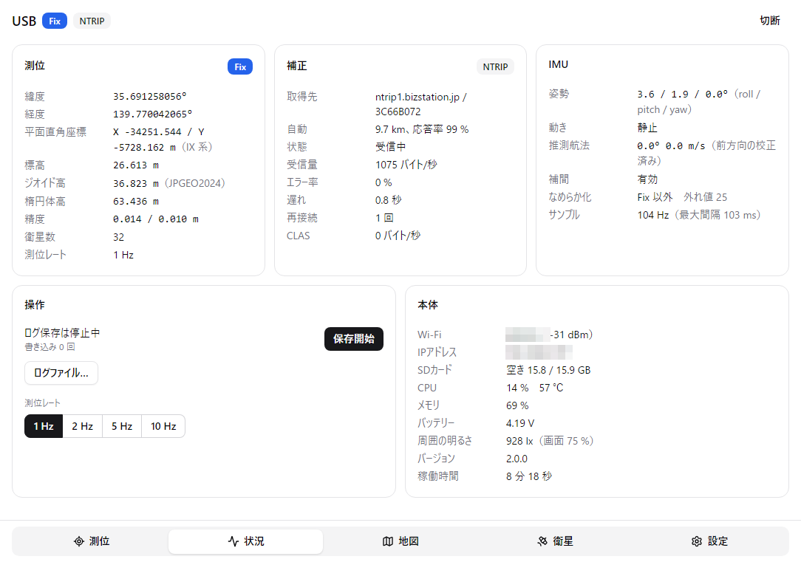

上端に、接続の名前(USB のときは `USB`、BLE のときは受信機名)、測位の状態、補正の方法が出ます。

| 枠 | 内容と操作 |
|---|---|
| 測位 | 緯度、経度、標高、ジオイド高(ジオイドモデルの名前。ないときは「F9P 内蔵」)、楕円体高、精度(水平 / 垂直)、衛星数、測位レート |
| 補正 | 取得先(自動で選んでいるときは、局までの距離と応答率も)、状態、受信量、エラー率、遅れ、再接続の回数、CLAS の受信量 |
| 本体 | Wi-Fi、IP アドレス、SD カードの空き、ログ(保存中かどうかと書き込み回数)、`ログファイル…`、CPU の使用率と温度、メモリ、バッテリー、バージョン、稼働時間 |

ログの保存の開始・停止と測位レートの切り替えは、測位タブで行います。

### ログファイル

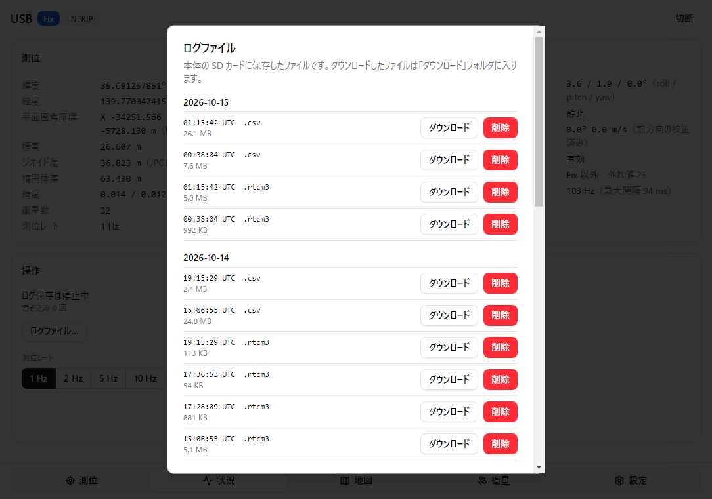

`ログファイル…` を押すと開きます。本体の SD カードにあるログを、日付ごとに並べます。`ダウンロード` で PC の「ダウンロード」フォルダに保存し、`削除` で本体から消します(消す前に確認が出ます)。`閉じる` で状況に戻ります。

USB で接続しているときだけ使えます。BLE のときは、ボタンが押せません。

## 地図

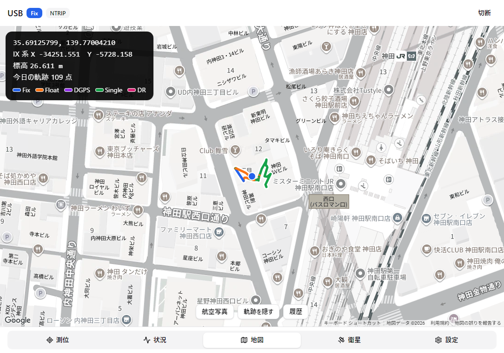

現在地と、今日の軌跡を表示します。左上に、座標(系を選んでいれば平面直角座標の X、Y も)、標高(ジオイドモデルがないときは楕円体高)、軌跡の点数が出ます(地図の上で読みやすいよう、黒地に白い文字)。この表示はタップすると閉じ、左上の i のボタンで開き直せます(選んだ状態は次回も同じ)。

- `航空写真` / `地図`: 地図の種類を切り替えます。
- `軌跡を隠す` / `軌跡を表示`: 軌跡の表示を入・切します。選んだ状態は、次に開いたときも同じです。
- `現在地`: 地図を動かしたあとに出ます。押すと、現在地の追従に戻ります。
- `履歴`: 「表示する日」を開きます。

地図は、軌跡と現在地の色が見分けやすいよう、彩度を抑えた配色で表示します(航空写真は変わりません)。

軌跡と現在地の点は、測位の状態で色を分けます。色は上部のバッジ、本体の画面のバッジと同じです(Fix は青、Float はオレンジ、DGPS は紫、Single は緑、DR はピンク。測位なしの現在地は赤)。軌跡には白い縁を付け、軌跡を表示している間は、左上に凡例が出ます。

Google Maps の API キーを設定していないときは、左上にその旨が出ます(「設定」のタブで入力します)。

### 表示する日

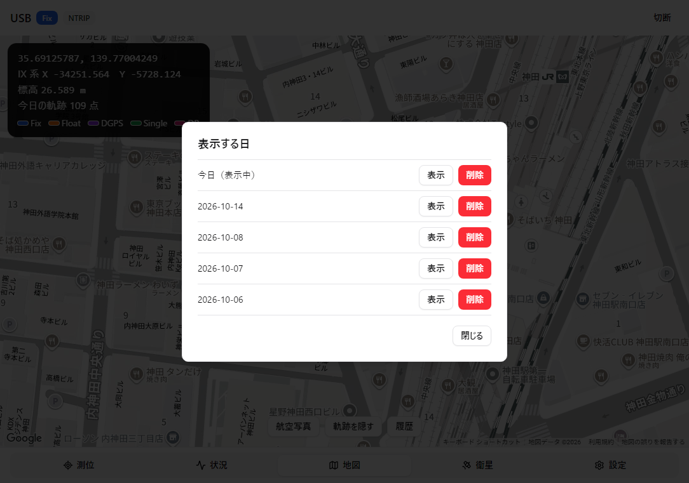

軌跡が残っている日の一覧です。`表示` でその日の軌跡を地図に出し、`削除` でその日の軌跡を消します。`閉じる` で地図に戻ります。

## 衛星

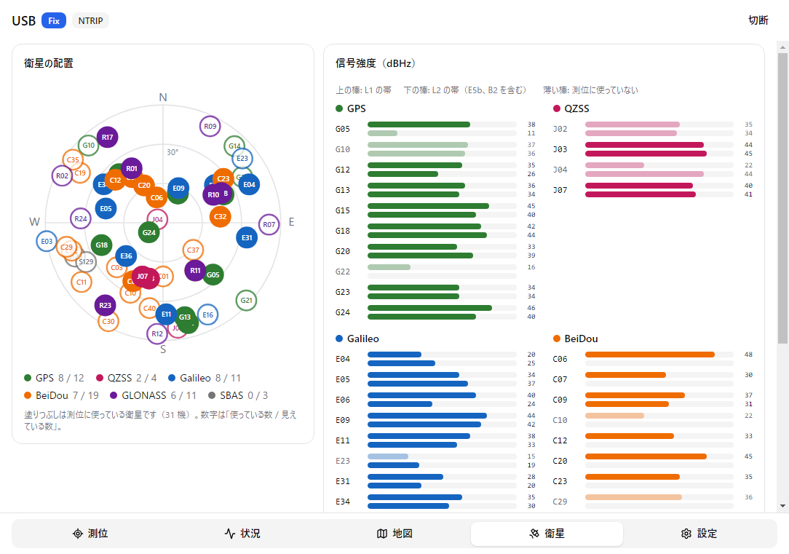

左は衛星の配置(スカイプロット)、右は衛星ごとの信号強度(上の帯が L1 の帯、下の帯が L2 の帯)です。塗りつぶした印と濃い帯が、測位に使っている衛星と信号です。表示だけで、ほかの画面には移りません。

このタブを開いている間だけ、本体に衛星の情報を問い合わせます。

## 設定

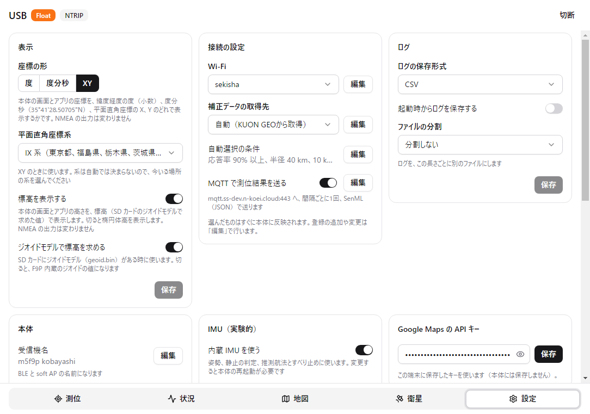

選択と入・切はこのタブで行い、自由入力(受信機名、ブローカー、ポート、しきい値)と一覧(Wi-Fi、補正データの取得先)は、項目のそばの `編集` で開くダイアログで行います。

| 枠 | 内容と操作 |
|---|---|
| 表示 | 平面直角座標系の系(測位タブの座標の形で XY を選んだときだけ)、標高を表示するかどうか(切ると楕円体高。NMEA は変わらない)、ジオイドモデルで標高を求めるかどうか |
| 接続の設定 | 使う Wi-Fi(「自動(KUON GEOから取得)」も選べる補正データの取得先と合わせて、`編集` で登録の一覧を開く)、自動選択の条件(`編集`)、MQTT で測位結果を送るかどうか(`編集` でブローカー、TLS、CA 証明書、ユーザー名とパスワード、トピック、間隔) |
| ログ | ログの保存形式(`CSV (カスタム)` は出す項目を選べる)、起動時からログを保存するかどうか、CSV (カスタム) で出す項目(`編集`)、ファイルの分割、タイムゾーン(ログの日時に使う) |
| 本体 | 受信機名(`編集`)、USB から NMEA も出力するか、BLE を使うか、ペアリングを使うか、BLE で NMEA を送る回数、soft AP を使うか(`編集` で IP アドレス)、測位データの配信(`編集` で TCP のポートと送信先)、PH コネクタのボーレートと出力フォーマット、`本体を再起動` |
| IMU(実験的) | 内蔵 IMU を使うか、IMU と GNSS の同時記録、推測航法での補間(`編集` で上限と劣化のしきい値)、座標のなめらか化 |
| Google Maps の API キー | 地図に使うキーを入力して `保存`。目のアイコンでキーの表示を切り替えます。この PC にだけ保存されます(本体には保存しません) |

起動時の設定(系、標高の表示、使う Wi-Fi と取得先、MQTT の入・切、保存形式、起動時から保存)は、変えた時点で本体に反映します(再起動しません)。設定ファイルの項目(ジオイドモデル、ファイルの分割、本体と IMU の枠)は、変えると枠の `保存` が押せるようになり、押すと変えた項目だけを本体に書き込みます。`編集` のダイアログは、そのダイアログの `保存` または `OK` で書き込みます。

再起動が要る項目(受信機名、BLE、soft AP、TCP サーバのポート、PH コネクタのボーレート、IMU の入・切)を変えたときは、保存のあとに再起動するかどうかを尋ねます。再起動するまでは、タブの上に帯が出て、設定ファイルの項目は変えられません。

### Wi-Fi と補正データの取得先の一覧

Wi-Fi と補正データの取得先の `編集` を押すと、登録の一覧のダイアログが開きます。`編集`、`削除`、並べ替え(↑↓)、追加ができ、項目の `編集` や追加を押すと、その項目の入力画面が重なって開きます(`OK` で一覧に反映)。本体に書き込むのは、一覧の `保存` を押したときです。`やめる` で閉じるときに変更があれば、捨ててよいかを尋ねます。

パスワードは本体から読み出しません。登録済みの項目には鍵の印が付き、入力欄は空のまま出ます(変えるときだけ入力します)。

| 画面 | 内容と操作 |
|---|---|
| 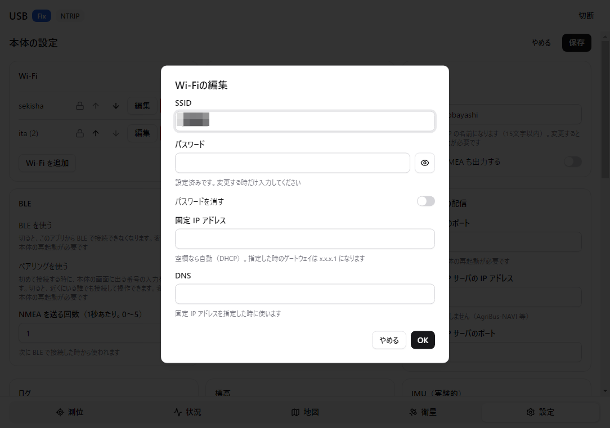 | **Wi-Fi の編集** SSID、パスワード、固定 IP アドレス、DNS。`OK` で一覧に反映し(本体への書き込みは `保存` を押したとき)、`やめる` で閉じます。 |
| 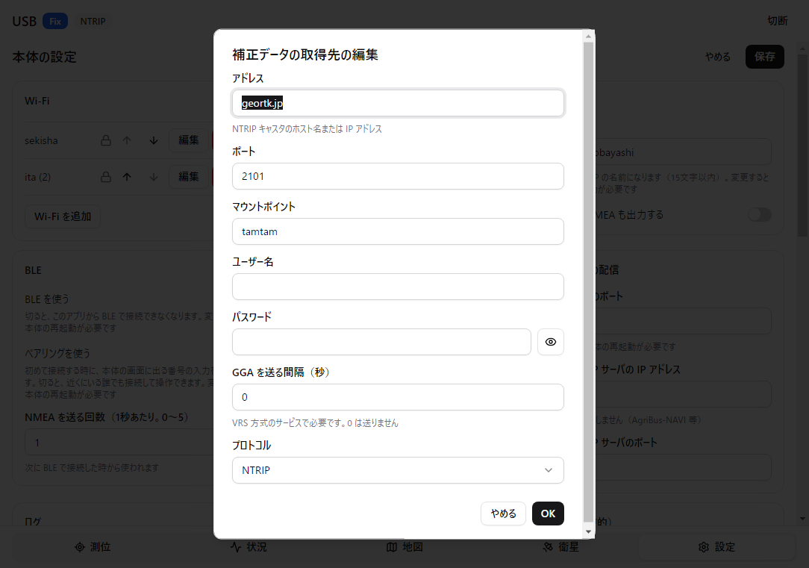 | **補正データの取得先の編集** アドレス、ポート、マウントポイント、ユーザー名、パスワード、GGA を送る間隔、プロトコル。操作は Wi-Fi の編集と同じです。 |

### 再起動の確認

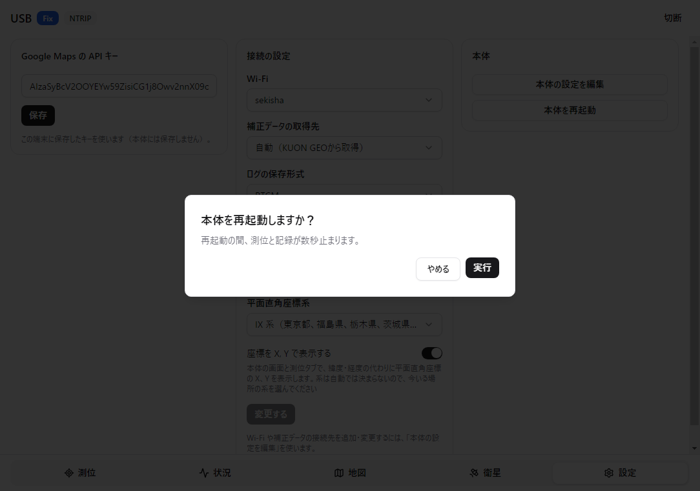

`本体を再起動` を押すと出ます。`実行` で本体が再起動し、`やめる` で設定に戻ります。
